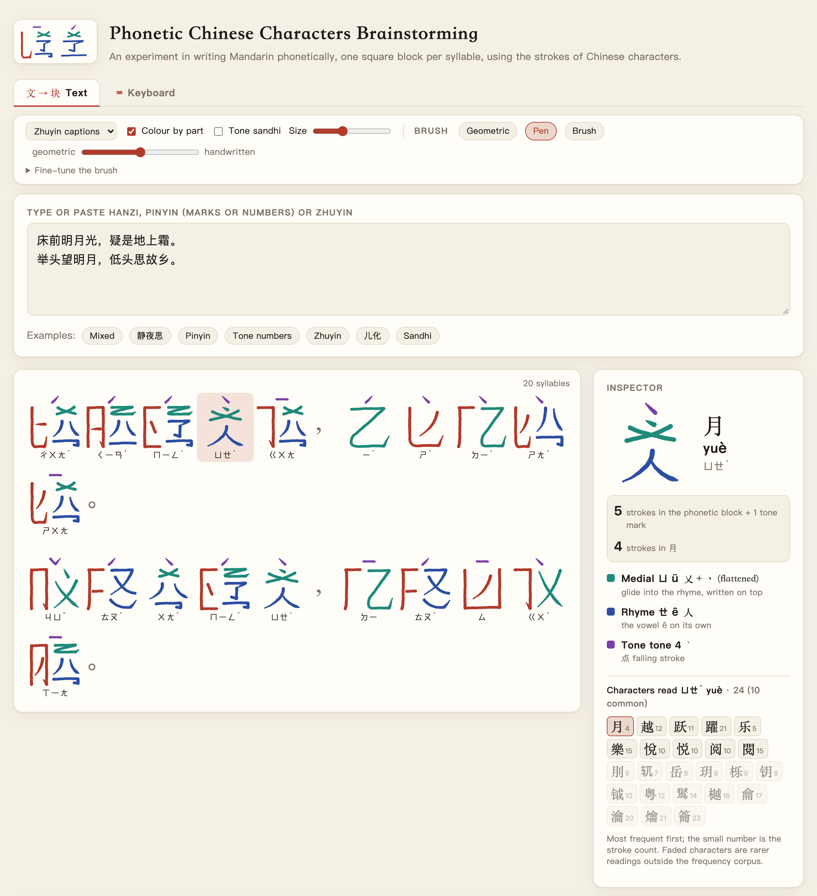
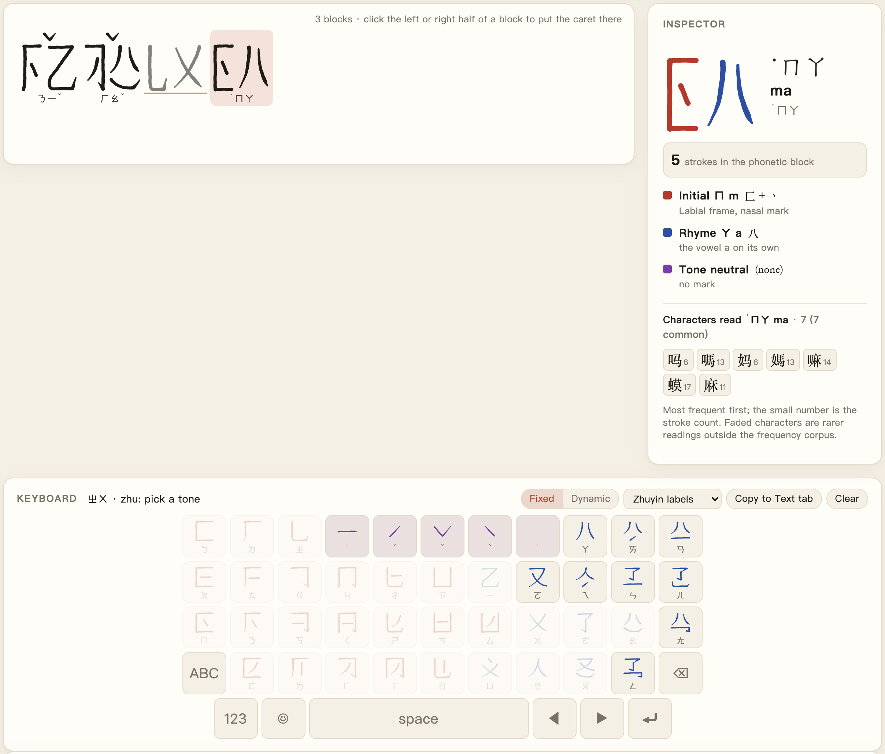
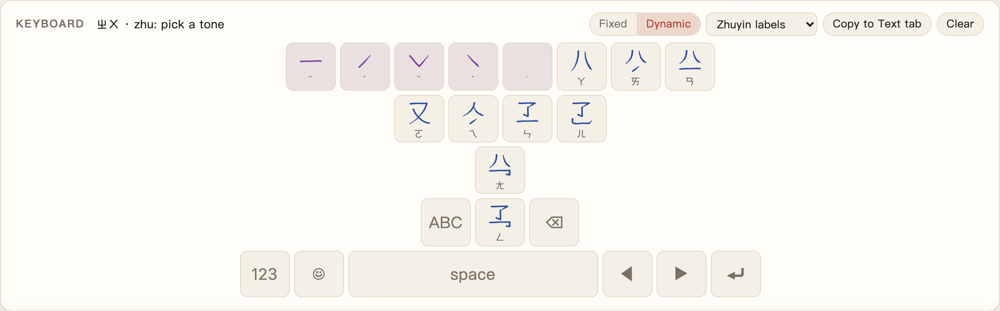
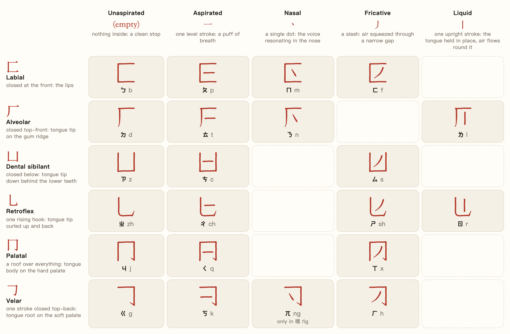
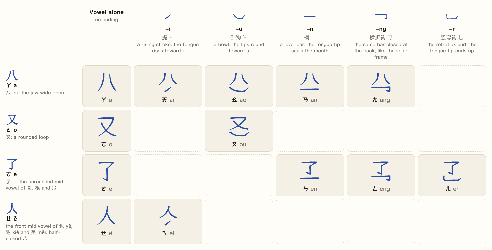
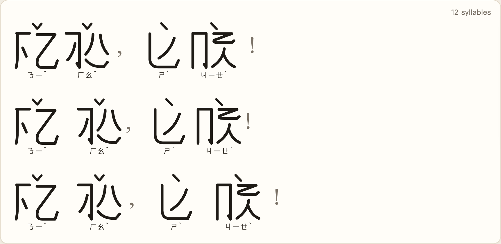
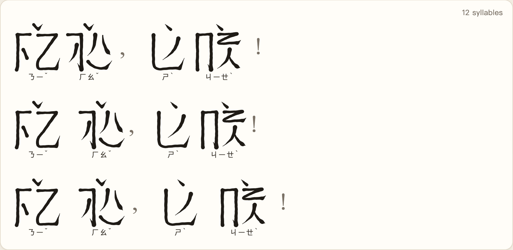

# Phonetic Chinese Characters Brainstorming

An experiment with a phonetic script for Mandarin where each syllable is
written as one square block. A block is assembled from a few stroke-based
parts (initial, medial ㄧㄨㄩ, rhyme, tone), following zhuyin's analysis of
the syllable. It is a brainstorm, not a tested or finished system.

The app (Rust + Dioxus) renders hanzi, pinyin or zhuyin in the script, and
includes a mock-up of an on-screen keyboard.





The keyboard can also hide the keys that can't continue the current syllable:







| Geometric strokes | Brush-like strokes |
|---|---|
|  |  |

## Running

```bash
dx serve --web
```

```bash
cargo test --no-default-features
```

Design notes are in [DESIGN.md](DESIGN.md). Hanzi readings come from the
`pinyin` crate. Stroke counts and reading frequencies come from the Unicode
Unihan database (`data/`, Unicode License v3).
